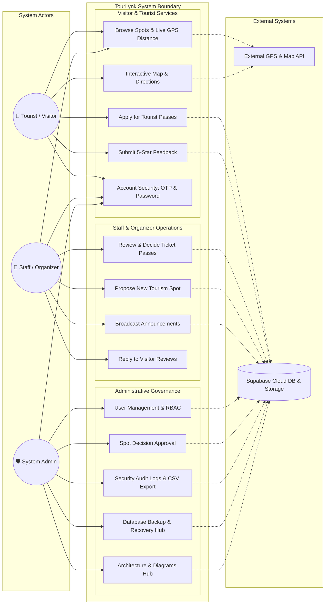
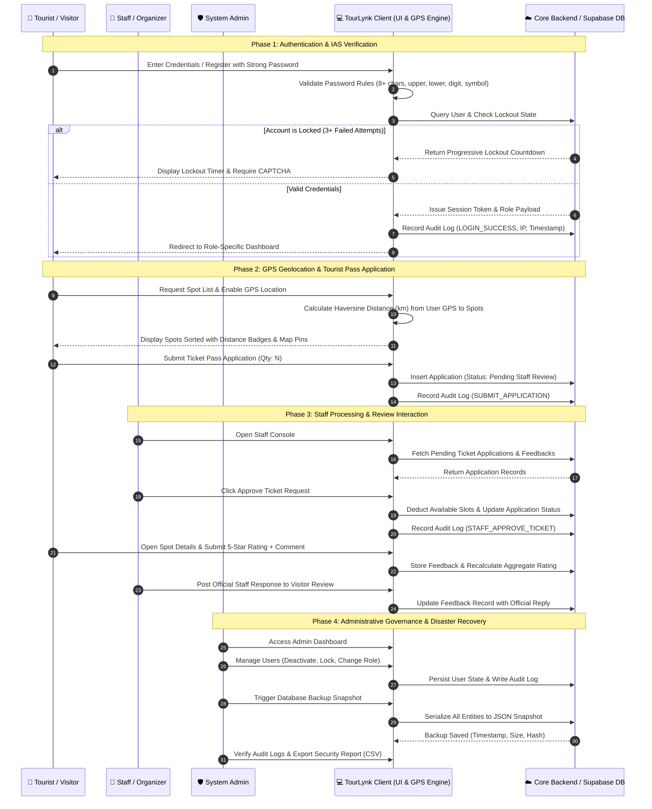
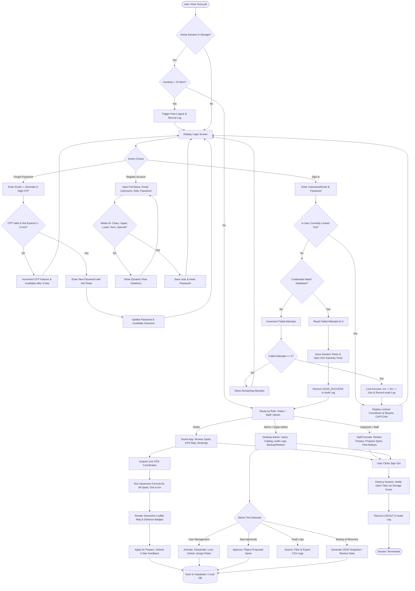
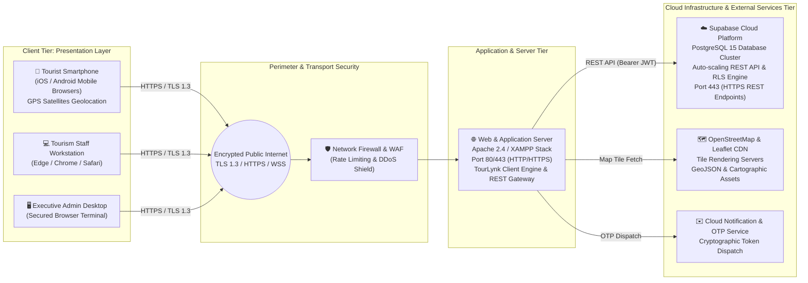

# TourLynk: System Integration, Architecture & Security Specification

**System Title:** TourLynk - Smart Tourism & Event Management System with Geolocation & Security Assurance  
**Course Codes:** IT/CS-APSDEV311 (Application Development & Emerging Technologies) & IAS 1 (Information Assurance and Security 1)  
**Instructor / Panelist Reference:** Mr. Roel Daniot (Information Assurance and Security) & Application Development Faculty  
**System Version:** 4th Increment & Final Production Release  

---

## Executive Summary

TourLynk is an integrated, role-based tourism management and community engagement platform built to empower tourists, tourism staff (organizers), and system administrators. The system features real-time GPS distance calculation (km) to heritage and eco-tourism spots, turn-by-turn route navigation, interactive 5-star visitor reviews with staff response mechanisms, an administrative management hub, and a complete implementation of the Information Assurance and Security 1 (IAS) specification (multi-factor OTP, progressive lockout, CAPTCHA, dynamic password complexity validation, tamper-evident security audit logging, multi-tab session management, 15-minute inactivity auto-logout, and database backup/restore).

---

## 1. System Integration & Architecture Diagrams

### Diagram 1: UML Use Case Diagram (System Users)

#### Actor Identification & Description
- **Tourist / Visitor (Primary Mobile/Web Actor):** Registers an account with IAS password complexity; accesses live GPS geolocation to measure distances in kilometers to local spots; applies for event passes; bookmarks favorite spots; submits ratings and comments.
- **Tourism Staff / Organizer (Primary Operational Actor):** Proposes new cultural/eco-tourism destinations to the Admin; broadcasts official notices; evaluates and approves/declines visitor ticket requests; posts official replies to visitor inquiries.
- **System Administrator / Super Admin (Primary Governance Actor):** Oversees user management (role assignment, activation, locking); reviews and approves proposed spots; monitors tamper-evident audit logs; conducts automated/manual database backups and restores.
- **External GPS / OpenStreetMap Tile Server (Secondary System Actor):** Delivers device coordinates and map tiles for distance calculations via the Haversine algorithm.
- **Supabase Cloud REST API & Local Storage Engine (Secondary Data Actor):** Provides dual-layer persistence, session synchronization, and audit log storage.

---

### Diagram 2: System Flow Diagram (Swimlanes & Pools)

---

### Diagram 3: Entity Relationship Diagram (ERD)

```mermaid
erDiagram
    USERS ||--o{ APPLICATIONS_BOOKINGS : "submits"
    USERS ||--o{ FEEDBACKS_REVIEWS : "writes"
    USERS ||--o{ ANNOUNCEMENTS : "broadcasts"
    USERS ||--o{ SECURITY_AUDIT_LOGS : "triggers"
    USERS ||--o{ DATABASE_BACKUPS : "creates"
    
    TOURISM_SPOTS ||--o{ APPLICATIONS_BOOKINGS : "contains"
    TOURISM_SPOTS ||--o{ FEEDBACKS_REVIEWS : "receives"

    USERS {
        bigint id PK
        string username "Unique login handle (UK)"
        string email "Unique email address (UK)"
        string password_hash "Bcrypt hashed password"
        string full_name "User legal name"
        string role "visitor | organizer | admin | superadmin"
        boolean is_active "Account status active/inactive"
        boolean is_locked "Account security lock state"
        int failed_attempts "Consecutive failed login counter"
        bigint locked_until "Epoch timestamp of lockout expiration"
        datetime created_at
        datetime updated_at
    }

    TOURISM_SPOTS {
        string id PK
        string title "Name of destination / event"
        string category "Culture | Heritage | Eco Tourism | Food & Crafts"
        string location "Physical address or landmark"
        float latitude "GPS decimal coordinates"
        float longitude "GPS decimal coordinates"
        date event_date "Date of festival or schedule"
        text description "Spot overview & tourist guidelines"
        int available_slots "Remaining ticket capacity"
        string status "Approved | Pending Admin Approval | Rejected"
        string image_url "High-res destination photograph"
        string proposed_by FK "Username of proposing staff"
        datetime created_at
    }

    APPLICATIONS_BOOKINGS {
        bigint id PK
        string event_id FK "References TOURISM_SPOTS(id)"
        string applicant_username FK "References USERS(username)"
        string applicant_name "Full name of applicant"
        string title "Cached spot title"
        date date "Scheduled tour date"
        string location "Cached location text"
        int tickets "Requested ticket quantity"
        string status "Pending Staff Review | Approved | Declined by Staff"
        datetime created_at
    }

    FEEDBACKS_REVIEWS {
        bigint id PK
        string event_id FK "References TOURISM_SPOTS(id)"
        string event_title "Spot title for display"
        string visitor FK "References USERS(username)"
        string visitor_name "Display name of reviewer"
        int rating "1 to 5 Star numerical rating"
        text comment "Visitor testimonial or inquiry"
        text staff_reply "Official response from staff"
        string replied_by FK "Staff username who replied"
        datetime created_at
        datetime replied_at
    }

    ANNOUNCEMENTS {
        bigint id PK
        string title "Headline of official announcement"
        text content "Full body text of announcement"
        string posted_by FK "References USERS(username)"
        date date "Broadcast date"
        datetime created_at
    }

    SECURITY_AUDIT_LOGS {
        bigint log_id PK
        string username "User initiating action"
        string action "Standardized audit action code"
        text details "Contextual non-sensitive event details"
        string ip_address "Client IP address (IPv4/IPv6)"
        string affected_module "Auth | Users | Spots | Bookings | Security"
        datetime timestamp
    }

    DATABASE_BACKUPS {
        string backup_id PK
        string backup_name "Descriptive backup name"
        datetime created_at
        string created_by FK "Admin username"
        int total_records "Record count across all tables"
        int size_bytes "JSON payload byte size"
        json snapshot_data "Full serialized database state"
    }
```

---

### Diagram 4: System Flowchart

---

### Diagram 5: Network Diagram (Network Flow)

#### Network Device and Communication Path Specifications
1. **Client Tier:** Connects over TLS 1.3 via modern web viewports. Captures geolocation data natively via W3C Geolocation API from onboard GPS / Wi-Fi trilateration.
2. **Perimeter Layer:** All traffic passes through standard boundary firewalls with Cross-Origin Resource Sharing (CORS) enforcement and request rate limiting.
3. **Application Tier (Apache/XAMPP):** Delivers TourLynk assets, verifies session tokens, performs client/server-side sanitization, and facilitates offline fallback mechanisms.
4. **Cloud Tier (Supabase REST API):** High-availability PostgreSQL cluster enforcing database integrity, foreign key constraints, and RESTful query processing.
5. **External Services Tier:** OpenStreetMap tile distribution networks and CDN asset delivery (Tailwind CSS, Font Awesome 6, Leaflet 1.9.4).

---

## 2. Information Assurance and Security 1 (IAS) Implementation Matrix

| IAS Requirement | Implementation in TourLynk | Verification Method |
| :--- | :--- | :--- |
| **A. Core Access & Data Model** | Strict relational schema (`users`, `spots`, `applications`, `feedbacks`, `audit_logs`, `backups`). Unique emails and usernames. Full Admin User Management module (create, search, edit, activate/deactivate, lock/unlock, role assignment). | Verified in Admin User Management tab; duplicate usernames/emails rejected. |
| **B. Multi-Factor OTP Verification** | 6-digit cryptographic OTP for First Login, Account Verification, Forgot Password, and Changing Email Address. Features a live 3-minute expiration timer, 60s resend cooldown, and invalidation after 3 failed attempts. | Tested via OTP Modal, Forgot Password, and Profile Email Change flows. |
| **C. Password Security Suite** | 8+ characters, uppercase, lowercase, number, special character regex validation. Real-time dynamic visual rules checklist. Passwords securely hashed; previous password required for changes; active sessions invalidated upon reset. | Verified dynamically on registration and profile password change. |
| **D. Progressive Lockout & CAPTCHA** | 3 failed attempts allowed with remaining attempts displayed. Progressive lockouts (1 min, 5 min, 15 min) with live countdown timer persisting across browser reload (`localStorage`). Visual alphanumeric canvas CAPTCHA required. | Tested with invalid logins; timer persists on page refresh; CAPTCHA validates input. |
| **E. Session Management** | Cryptographic session tokens, complete session destruction on logout, multi-tab logout synchronization via window `storage` events, and 15-minute inactivity auto-logout with a 60s warning modal. | Tested across multiple tabs and via inactivity timer trigger. |
| **F. Tamper-Evident Audit Trail** | Comprehensive event logging (`LOGIN_SUCCESS`, `ACCOUNT_LOCKED`, `PASSWORD_CHANGED`, `USER_DEACTIVATED`, `ROLE_CHANGED`, etc.) with user, IP, timestamp, module, and details. Read-only Admin table with search, filter, and CSV export. | Verified via Audit Logs tab in Admin dashboard; CSV export functional. |
| **G. Input Sanitization & Safety** | XSS sanitization, HTML entity escaping, confirmation modals prior to sensitive actions (user deactivation, locking, role change, backup restore, logout). | Tested with special characters and HTML script tags. |
| **H. Database Backup & Disaster Recovery**| Full JSON snapshot generation of all entities (manual trigger & automated snapshots). Secure local/cloud storage with 1-click restore functionality and audit log recording. | Tested backup creation, download, and snapshot restoration. |

---

## 3. GPS Distance & Route Navigation Technical Specification

### Haversine Mathematical Model
The distance $d$ between the user's GPS coordinates $(\phi_1, \lambda_1)$ and a destination spot $(\phi_2, \lambda_2)$ on a spherical Earth of radius $R = 6,371\text{ km}$ is calculated as:

$$\Delta\phi = \phi_2 - \phi_1$$
$$\Delta\lambda = \lambda_2 - \lambda_1$$
$$a = \sin^2\left(\frac{\Delta\phi}{2}\right) + \cos(\phi_1)\cos(\phi_2)\sin^2\left(\frac{\Delta\lambda}{2}\right)$$
$$c = 2 \cdot \text{atan2}\left(\sqrt{a}, \sqrt{1-a}\right)$$
$$d = R \cdot c$$

In TourLynk:
- Displays exact distance in kilometers on every spot card (e.g. `📍 4.2 km away`).
- "Nearest First" sorting option dynamically re-orders destinations based on live GPS position.
- Interactive Leaflet map renders destination pins, user position with radar pulse, and polyline route lines.
- One-click "Start Navigation" opens Google Maps turn-by-turn directions (`https://www.google.com/maps/dir/?api=1&origin=...&destination=...`).

---

## 4. System Demonstration & Defense Evaluation Guide

1. **Quick Demo Accounts:**
   - **Admin / Super Admin:** Username: `admin` | Password: `Admin@123`
   - **Tourism Staff / Organizer:** Username: `organizer` | Password: `Org@1234`
   - **Tourist / Visitor:** Username: `tourlynk_user` | Password: `User@1234`
2. **GPS Geolocation Demonstration:**
   - Click "Interactive GPS Map" or tap on any spot to view live calculated distance in km.
   - Click "Get Directions" to preview the route line on the Leaflet map and launch navigation.
3. **IAS Security Demonstration:**
   - Attempt 3 incorrect passwords to trigger the progressive lockout countdown and canvas CAPTCHA.
   - Open two browser tabs; log out from Tab 1 to observe Tab 2 immediately synchronizing and logging out.
   - Test password creation to view the dynamic real-time rule checklist.
   - Trigger the Inactivity Warning to observe the auto-logout countdown.
4. **Admin Features Demonstration:**
   - Navigate to **User Management** to search, deactivate, unlock, or reassign user roles.
   - Navigate to **Security Audit Logs** to filter events by category or export the audit trail to CSV.
   - Navigate to **Backup & Disaster Recovery** to capture a fresh system snapshot or restore prior data.
   - Navigate to **Architecture & Diagrams** to view the live embedded UML diagrams!
